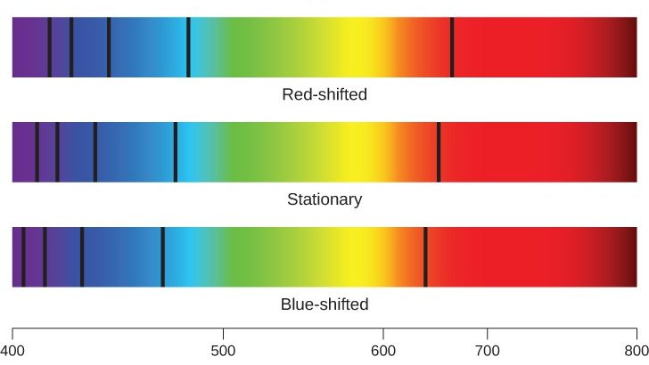
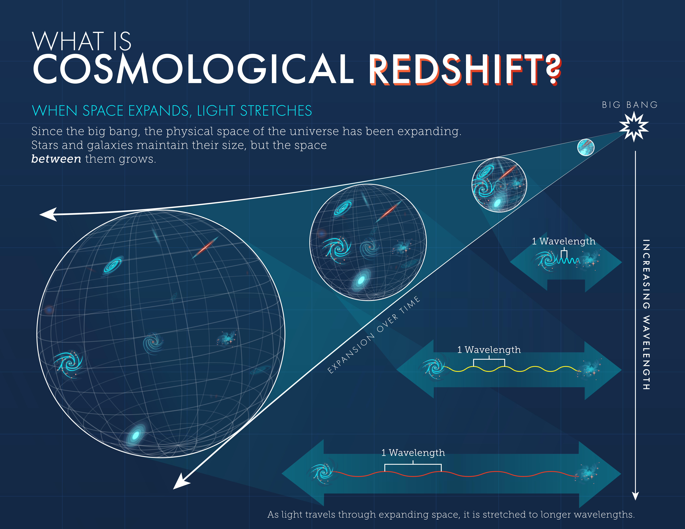

# Redshift e Evidências de Expansão do Universo

A expansão do universo é o aumento da distância, ao longo do tempo, entre partes do universo observável que não estão gravitacionalmente ligadas.

As primeiras teorias cosmologicas sobre o universo apresentavam um universo estático, que não se expandia. Em 1917, Eintein adicionou a constante cosmológica as equações da relatividade geral como forma de sustentar a ideia de que o universo era estático, a constante representava uma força que impedia que a gravidade fizesse todas as galáxias se atraírem e o Universo colapsasse. Independetemente, a partir de observações do red-shift de galaxias, sugeriram soluções das equações da relatividade geral em que o universo estaria se expandindo. Finalmente, em 1929, Hubble relacionou o redshift das galáxias às suas distâncias, fornecendo a evidência observacional decisiva de que o Universo realmente se expande.

Durante décadas, acreditou-se que a gravidade faria a expansão do Universo desacelerar. Porém, no final dos anos 1990, observações de supernovas distantes mostraram o contrário: a expansão está se acelerando. Para explicar esse efeito, os cientistas propuseram a existência da energia escura — e a constante cosmológica, antes abandonada por Einstein, voltou ao centro da cosmologia.

> [!TIP] O Maior Erro de Eintein?
> Einstein incluiu a constante cosmológica para tornar o Universo estático, mas a abandonou quando Hubble mostrou que ele se expandia; segundo relatos, chamou sua inclusão de “seu maior erro”. Hoje, ela voltou como explicação para a energia escura e a aceleração da expansão do Universo.

## O Redshift

A luz emitida pelas galáxias apresenta linhas espectrais, associadas à emissão e absorção de radiação em comprimentos de onda específicos pelos elementos químicos. Essas linhas permitem identificar a composição química dos objetos astronômicos.

Ao observar galáxias distantes, os astrônomos perceberam que essas linhas aparecem deslocadas para comprimentos de onda maiores, fenômeno conhecido como redshift (desvio para o vermelho).

Esse deslocamento pode ser quantificado por:
\[
z = \frac{\lambda_{\text{obs}}-\lambda_{\text{emit}}}{\lambda_{\text{emit}}}
\]

em que \(\lambda_{\text{obs}}\) é o comprimento de onda observado e \(\lambda_{\text{emit}}\) é o emitido originalmente.

No contexto cosmológico, o redshift ocorre porque a expansão do espaço alonga o comprimento de onda da luz durante sua propagação. Assim, quanto maior o redshift cosmológico, maior foi a expansão do Universo desde que aquela luz foi emitida.

## A Lei de Hubble

Em 1929, Edwin Hubble relacionou o redshift das galáxias às suas distâncias. Ele descobriu que, em média, **galáxias mais distantes apresentam redshifts maiores**, ou seja, parecem se afastar mais rápido.

Essa relação é expressa pela **Lei de Hubble–Lemaître**:

$$
v \approx H_0 d
$$

em que:

- **v** é a velocidade de afastamento;
- **d** é a distância;
- **H₀** é a constante de Hubble, que descreve a taxa atual de expansão do Universo.

## A expansão acelerada

Durante muito tempo, os cientistas imaginaram que a gravidade deveria desacelerar a expansão do Universo, já que toda matéria atrai matéria. Porém, no final dos anos 1990, observações de supernovas muito distantes revelaram que a expansão está se **acelerando**.

Para explicar esse resultado, os cosmólogos propuseram a existência de uma componente misteriosa chamada **energia escura**. Ela teria um efeito repulsivo em escalas muito grandes, vencendo a atração gravitacional da matéria e fazendo o Universo se expandir cada vez mais rápido.

## Energia escura e constante cosmológica

A explicação mais simples para a energia escura é justamente a **constante cosmológica** de Einstein. Ela representa uma energia associada ao próprio vácuo, presente em todo o espaço e que não diminui quando o Universo se expande.

Hoje, a constante cosmológica faz parte do modelo padrão da cosmologia, chamado **ΛCDM**. Nesse modelo, a energia escura corresponde a cerca de 68% do conteúdo de massa-energia do Universo, enquanto a matéria escura e a matéria comum compõem o restante.

# Referências

BAGDONAS, Alexandre; ZANETIC, João; GURGEL, Ivã. Quem descobriu a expansão do universo? Disputas de prioridade como forma de ensinar cosmologia com uso da história e filosofia da ciência. Revista Brasileira de Ensino de Física, v. 39, n. 2, 2017. DOI: https://doi.org/10.1590/1806-9126-RBEF-2016-0257. Disponível em: https://www.scielo.br/j/rbef/a/Wb7Dtb36NHgVKH7LJg8grzN/. Acesso em: 19 nov. 2026.

Fonte: [NASA — Dark Energy](https://science.nasa.gov/dark-energy/)

Fonte: [NASA — What Is Cosmological Redshift?](https://science.nasa.gov/asset/webb/what-is-cosmological-redshift/)